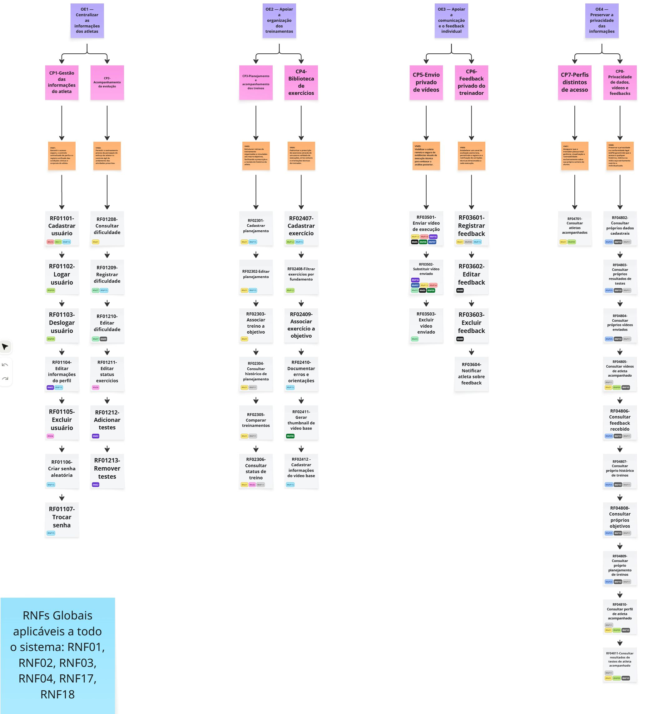
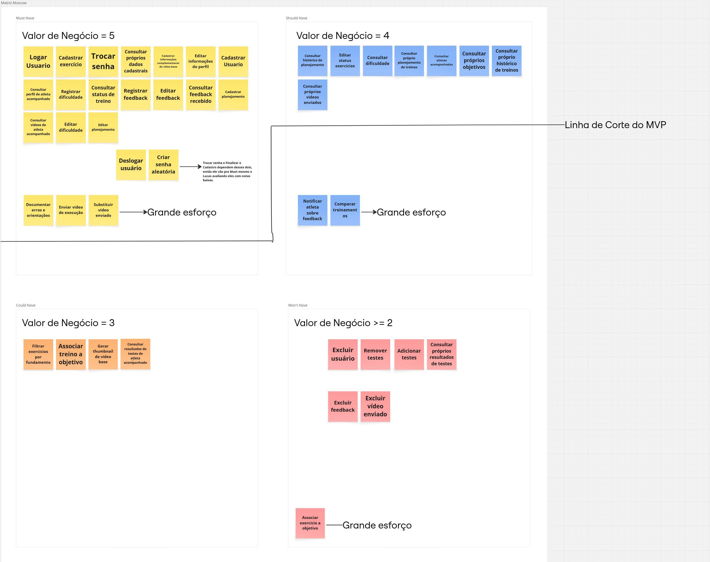

# Matrizes do Miro

Versões históricas de consulta dos artefatos de rastreabilidade e priorização. As capturas foram registradas em **11/11/2026, v01**; essa data identifica a captura, não a criação ou a aprovação original. A reformulação posterior dos requisitos pode não estar representada nestas imagens.

O [catálogo funcional](requisitos.md) mantém os registros textuais publicados. As matrizes não constituem um segundo catálogo de manutenção. [Abrir o quadro no Miro](https://miro.com/app/board/uXjVHrFoSVo=/).

## Matriz de rastreabilidade

[Abrir a imagem original](imagens/artefatos-miro/matriz-rastreabilidade-v01.jpg) · [Consultar a origem no Miro](https://miro.com/app/board/uXjVHrFoSVo=/?moveToWidget=3458764686792804852)

## Matriz MoSCoW

[Abrir a imagem original](imagens/artefatos-miro/matriz-moscow-v01.jpg) · [Consultar a origem no Miro](https://miro.com/app/board/uXjVHrFoSVo=/?moveToViewport=1026%2C11267%2C2291%2C2023)

## Identificação

[Origem, versão, data e identificação dos arquivos](imagens/artefatos-miro/capturas-2026-11-11-v01.json).

Novas versões devem identificar a captura e a correspondência com os documentos vigentes. As imagens históricas não comprovam atualização do quadro, execução do planejamento ou validação dos requisitos.
