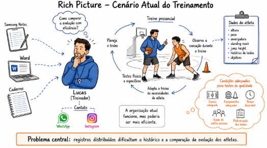
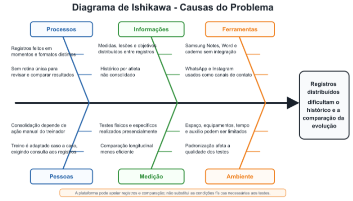
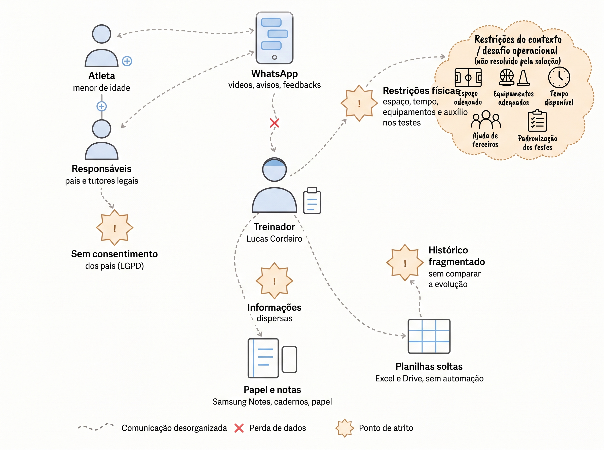

# 1. Cenário Atual do Cliente e do Negócio

## 1.1 Identificação do Cliente/Parceiro

- **Nome:** Lucas Cordeiro (Professor/Treinador de Basquete).
- **Atuação:** Treinador autônomo de basquete, com foco principal em atendimentos individuais e possibilidade de turmas ou escolinhas.
- **Representante:** Lucas Cordeiro.
- **Formas de contato:** WhatsApp e Teams.
- **Vínculo com o projeto:** Cliente real e parte interessada principal, responsável por apresentar e validar informações sobre o negócio, participar da elicitação e confirmar necessidades e requisitos do produto.

## 1.2 Introdução ao Negócio e Contexto

O professor Lucas atua na instrução e no desenvolvimento técnico de atletas de basquete,
principalmente por meio de treinos presenciais individuais. O acompanhamento ocorre durante as
aulas, com observação da execução e aplicação de testes físicos e específicos da modalidade. A partir
dos resultados e das necessidades de cada atleta, Lucas adapta o treinamento.

O contato com atletas e potenciais clientes ocorre pelo WhatsApp e pelo Instagram. Para planejar e organizar treinos e informações dos atletas, Lucas utiliza
Samsung Notes, Word e um caderno. Além disso, será utilizado o Teams para futuras reuniões.

Durante o treino presencial, Lucas demonstra exercícios, observa e corrige a execução, realiza
testes e ajusta o planejamento. Entre as informações que considera relevantes estão altura, peso,
envergadura, standing reach, jump height, histórico de lesões e objetivos.

A organização atual funciona, mas poderia ser mais eficiente. Como os registros ficam distribuídos
entre Samsung Notes, Word e caderno, localizar informações, manter um histórico e comparar a
evolução dos atletas exige consolidação manual. Além disso, a qualidade dos testes depende de
condições adequadas de espaço, equipamentos, tempo, auxílio de outras pessoas e padronização.

## 1.3 Rich Picture

A Rich Picture a seguir representa somente o cenário atual: contato por WhatsApp e Instagram, organização em Samsung Notes, Word e caderno, treinos e testes presenciais, adaptação individual e dificuldades de histórico e comparação.

*Figura 1 — Rich Picture do cenário atual do acompanhamento dos atletas.*

## 1.4 Identificação da Oportunidade ou Problema

### Problema central

Os registros de planejamento, perfil e resultados de testes ficam distribuídos entre Samsung Notes,
Word e caderno, o que torna menos eficiente manter o histórico e comparar a evolução dos atletas.

### Problemas observados

- **Registros distribuídos:** planejamento, dados do atleta e resultados dos testes são mantidos
em ferramentas distintas.
- **Histórico fragmentado:** a consulta da trajetória de cada atleta depende da reunião manual
dos registros.
- **Comparação menos eficiente:** acompanhar mudanças nas medidas e nos resultados ao
longo do tempo exige consolidação manual.
- **Restrição operacional dos testes:** a qualidade dos testes presenciais depende de
espaço, equipamentos, tempo, auxílio e padronização adequados.

### Análise das causas

As causas foram organizadas nas categorias Processos, Informações, Ferramentas, Pessoas,
Medição e Ambiente. O diagrama de Ishikawa evidencia a combinação entre registros feitos em
momentos e formatos distintos, informações distribuídas, ausência de integração entre Samsung
Notes, Word e caderno, consolidação manual, comparação longitudinal pouco eficiente e limitações
nas condições de realização dos testes.

*Figura 2 — Diagrama de Ishikawa das causas da fragmentação dos registros e da comparação menos eficiente.*

### Oportunidade

Há a oportunidade de centralizar o perfil do atleta, resultados de testes, planejamento, exercícios e
histórico, tornando a consulta e a comparação da evolução mais eficientes. Lucas confirmou que uma
plataforma com esses elementos resolveria uma dificuldade relevante de sua rotina. A solução
poderá apoiar o registro e a análise das informações, sem substituir as condições físicas necessárias
à realização de testes de qualidade.

## 1.5 Desafios do Projeto

- **Elicitação e validação:** compreender a rotina real do treinador e validar decisões com
Lucas, cuja disponibilidade pode influenciar o ritmo das entrevistas.

- **Delimitação entre problema e solução:** manter a documentação do cenário atual separada
das decisões sobre o produto proposto.

- **Privacidade e consentimento:** tratar vídeos de atletas e feedbacks individuais como
informações privadas, com acesso restrito.

- **Condições de teste e limites da solução:** reconhecer que a plataforma apoia registros,
histórico e comparação, mas não substitui espaço, equipamentos, tempo, auxílio ou
padronização necessários aos testes.

- **Restrição de escopo acadêmico:** priorizar um MVP realizável durante a disciplina e
manter ranking, métricas avançadas e expansão para outras modalidades como evoluções futuras.

## 1.6 Mapa de Stakeholders

O mapa de stakeholders reúne as partes interessadas que influenciam ou são afetadas pelo
acompanhamento dos atletas de Lucas. Ele considera tanto os atores já presentes no cenário atual
quanto os que podem surgir com a operação futura da plataforma, sempre sinalizando com clareza
quem já atua hoje e quem ainda não existe.

| Parte interessada | Relação com o contexto | Interesse | Influência | Situação no cenário atual |
| --- | --- | --- | --- | --- |
| **Lucas Cordeiro** | Treinador/professor autônomo e cliente; centraliza o planejamento e o acompanhamento. | Alto | Alta | Atua diretamente e é a principal fonte de informação sobre o negócio. |
| **Atletas** | Praticantes de basquete acompanhados, em diferentes níveis de experiência. | Alto | Alta | A participação direta ainda depende de validação; ver observações abaixo e a Seção 1.7. |
| **Pais ou responsáveis** | Responsáveis legais por atletas menores de idade. | Alto | Média | **Condicional:** passam a integrar o mapa apenas se existirem atletas menores. |
| **Equipe de desenvolvimento** | Equipe "Stakeholders Anônimos" (seis integrantes). | Alto | Alta | Responsável pela elicitação, documentação e validação junto ao cliente. |
| **Administrador futuro da plataforma** | Papel previsto para a operação do produto, com responsabilidades de gestão de contas, permissões e privacidade. | Médio | Baixa no contexto atual | **Não existe no cenário atual**; antecipado para as evoluções da solução. |
| **Profissionais de apoio** | Fisioterapeuta, preparador físico ou avaliador de testes ou lesões. | — | — | **Não participam** do cenário atual nem do fluxo de informações; não integram o diagrama. |

É importante registrar que as necessidades atribuídas aos atletas — consultar planejamento, histórico
e exercícios, além de enviar vídeos — foram levantadas principalmente a partir da visão do treinador.
Elas **não devem ser tratadas como confirmadas** enquanto não houver evidência direta de participação
dos atletas na elicitação e na validação. A equipe reconhece que faixa etária, quantidade de atletas,
dispositivos mais utilizados e necessidades de acessibilidade ainda dependem de validação, tema
detalhado na Seção 1.7.

Os **pais ou responsáveis** passam a integrar o mapa somente na hipótese de existirem atletas menores
de idade. Nesse caso, o consentimento para uso de imagem e a proteção de dados de menores tornam-se
elementos centrais do contexto e exigem atenção à LGPD.

O **administrador futuro da plataforma** ainda não existe no cenário atual. Sua inclusão antecipa as
responsabilidades de gestão de contas, permissões de acesso e privacidade que poderão surgir na
operação do produto, sem confundi-lo com os atores que já atuam hoje.

Além das partes interessadas do negócio, o docente e o monitor da disciplina acompanham e avaliam o
projeto em seu contexto acadêmico, contribuindo para a revisão dos artefatos e do processo.

{: width="720" }

*Figura 3 — Mapa de stakeholders do cenário atual do acompanhamento dos atletas.*

**Como ler a Figura 3.**

**Atores e stakeholders**

- **Treinador (Lucas Cordeiro):** atua no centro da gestão pedagógica dos treinos.
- **Atleta (menor de idade):** à esquerda, vincula-se diretamente aos seus **Responsáveis**
  (pais/tutores legais).
- **Ausência de profissionais de apoio:** fisioterapeutas, preparadores físicos e demais
  profissionais de saúde **não aparecem no diagrama**, pois não participam do fluxo de informações
  no cenário atual.

**Legenda da notação visual**

- **Linha pontilhada cinza — comunicação desorganizada:** mapeia o fluxo informal, assíncrono e sem
  padronização de dados entre os atores e os canais de informação (WhatsApp, papéis, notas e
  planilhas).
- **Ícone ❌ vermelho — perda de dados:** indica bloqueios ou falhas de comunicação, como os vídeos
  recebidos via WhatsApp que perdem o vínculo com o feedback registrado pelo treinador.
- **Símbolo de alerta bege — ponto de atrito:** destaca os gargalos operacionais e os riscos do
  cenário atual:
    - **Sem consentimento dos pais (LGPD):** ausência de um fluxo formal para autorização do
      tratamento de dados e vídeos de atletas menores de idade.
    - **Vídeos perdidos:** falta de rastreabilidade entre os exercícios enviados e as correções do
      treinador.
    - **Restrições físicas:** desafios operacionais do contexto (espaço, equipamentos e auxílio em
      testes) que impactam a rotina presencial.
    - **Informações dispersas e histórico fragmentado:** registros divididos entre papel, Samsung
      Notes e Excel, inviabilizando a análise contínua da evolução dos atletas.

Dessa forma, o mapa permite distinguir o que já faz parte da rotina de Lucas do que ainda depende de
validação, evitando tratar como confirmadas as necessidades dos atletas apresentadas apenas pela
ótica do treinador.

## 1.7 Segmentação de "Clientes" (Usuários da Plataforma)

### Professor/Treinador

**Perfil de negócio:** treinador autônomo responsável por planejar treinos, demonstrar exercícios,
observar a execução e fornecer correções individualizadas.

**Perfil tecnológico considerado:** utiliza smartphone, WhatsApp e Instagram para contato, além de
Samsung Notes, Word e caderno para organizar treinos e informações. A proposta deve exigir
operações simples de cadastro, consulta, registro, comparação e compartilhamento de conteúdo.

### Atletas

**Perfil de uso:** praticantes de basquete em diferentes níveis de experiência, acompanhados
principalmente em treinos presenciais. Para o acompanhamento individual, Lucas considera altura,
peso, envergadura, standing reach, jump height, histórico de lesões e objetivos.

**Perfil tecnológico considerado:** acesso a smartphone com câmera, navegador e internet, além de
familiaridade básica com mensagens, reprodução e envio de vídeos.

**Limites das informações disponíveis:** faixa etária predominante, quantidade de atletas,
dispositivos mais utilizados e necessidades específicas de acessibilidade ainda dependem de
validação com Lucas.
