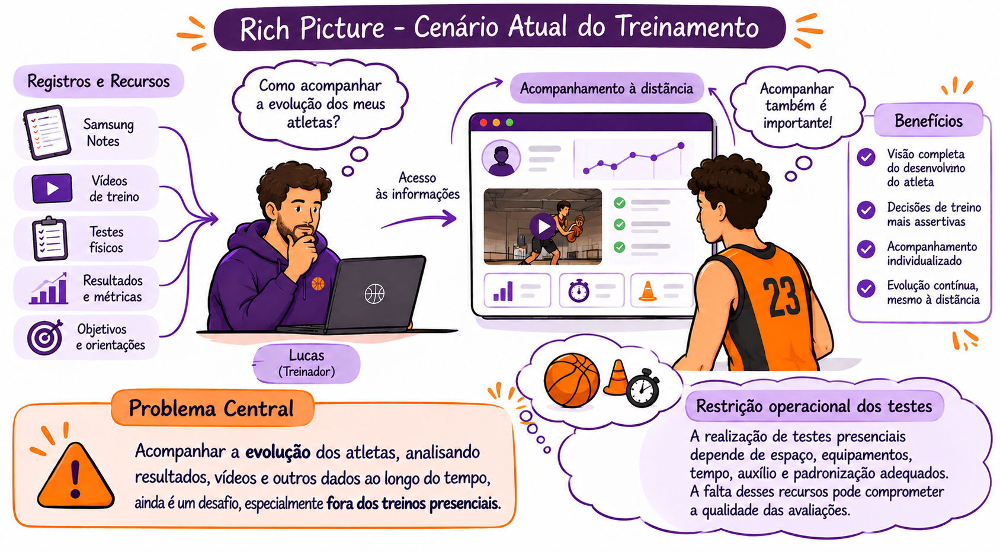
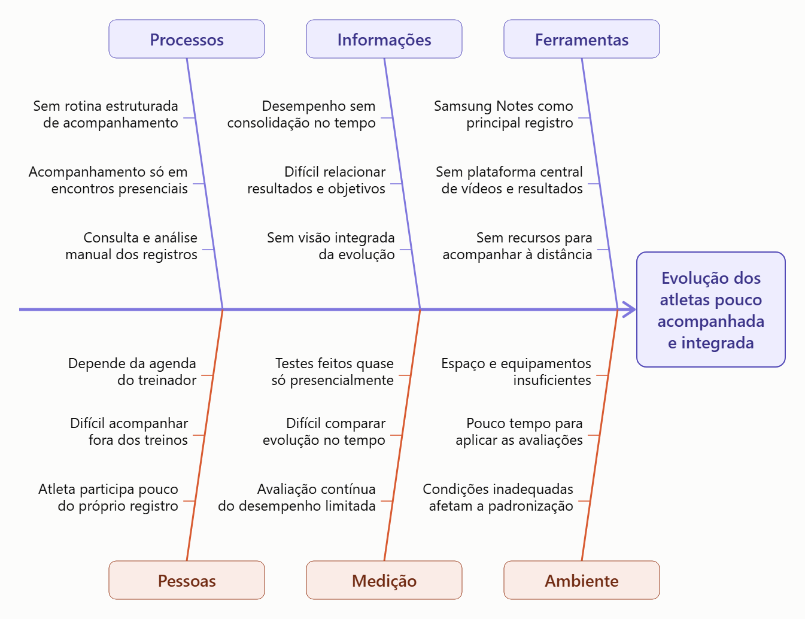
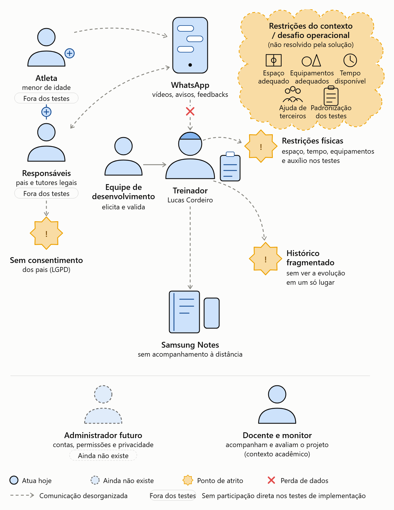

# 1. Cenário Atual do Cliente e do Negócio

## 1.1 Identificação do Cliente/Parceiro

- **Nome:** Lucas Cordeiro (Professor/Treinador de Basquete).
- **Atuação:** Treinador autônomo de basquete, com foco principal em atendimentos individuais e possibilidade de turmas ou escolinhas.
- **Representante:** Lucas Cordeiro.
- **Formas de contato:** WhatsApp e Teams.
- **Vínculo com o projeto:** Cliente real e parte interessada principal, responsável por apresentar e validar informações sobre o negócio, participar da elicitação e confirmar necessidades e requisitos do produto.

## 1.2 Introdução ao Negócio e Contexto

O professor Lucas atua na instrução e no desenvolvimento técnico de atletas de basquete,
principalmente por meio de treinos presenciais individuais. O acompanhamento ocorre durante as
aulas, com observação da execução e aplicação de testes físicos e específicos da modalidade. A partir
dos resultados e das necessidades de cada atleta, Lucas adapta o treinamento.

O contato com atletas e potenciais clientes ocorre pelo WhatsApp e pelo Instagram. Para planejar e organizar treinos e informações dos atletas, Lucas utiliza
Samsung Notes, Word e um caderno. Além disso, será utilizado o Teams para futuras reuniões.

Durante o treino presencial, Lucas demonstra exercícios, observa e corrige a execução, realiza
testes e ajusta o planejamento. Entre as informações que considera relevantes estão altura, peso,
envergadura, standing reach, jump height, histórico de lesões e objetivos.

A organização atual funciona, mas poderia ser mais eficiente. Como os registros ficam distribuídos
entre Samsung Notes, Word e caderno, localizar informações, manter um histórico e comparar a
evolução dos atletas exige consolidação manual. Além disso, a qualidade dos testes depende de
condições adequadas de espaço, equipamentos, tempo, auxílio de outras pessoas e padronização.

## 1.3 Rich Picture

A Rich Picture a seguir representa somente o cenário atual: contato por WhatsApp e Instagram, organização em Samsung Notes, Word e caderno, treinos e testes presenciais, adaptação individual e dificuldades de histórico e comparação.

{:  width="524" height="290" }

*Figura 1 — Rich Picture do cenário atual do acompanhamento dos atletas.*

## 1.4 Identificação da Oportunidade ou Problema

### Problema central

**Problema central**

O treinador enfrenta dificuldades para acompanhar continuamente o desenvolvimento individual dos atletas, especialmente fora dos encontros presenciais, e para visualizar e comparar sua evolução ao longo do tempo. Embora as informações de planejamento, testes e desempenho sejam registradas principalmente no Samsung Notes, a ausência de recursos integrados para organizar o histórico, relacionar resultados e acompanhar a execução dos exercícios limita a análise do progresso e a identificação de necessidades de adaptação dos treinamentos.

**Evolução do entendimento do problema**

Inicialmente, a equipe identificou a dispersão dos registros como o principal problema do negócio. Entretanto, após novas interações com Lucas, verificou-se que as informações são mantidas principalmente no Samsung Notes e que a necessidade mais relevante está relacionada ao acompanhamento da evolução individual dos atletas, inclusive à distância. Dessa forma, a organização e a centralização das informações passaram a ser compreendidas como meios para solucionar o problema mais amplo de acompanhamento contínuo, e não como objetivos isolados.

### Problemas observados

- **Acompanhamento à distância:** a dificuldade de monitorar os atletas fora dos encontros presenciais limita a percepção do treinador sobre seu desenvolvimento durante a rotina de treinos.
- **Visualização da evolução:** a ausência de recursos que permitam observar e comparar o desempenho ao longo do tempo dificulta identificar avanços e pontos que precisam de melhoria.
- **Falta de recursos integrados:** vídeos, testes físicos, avaliações e registros de desempenho são ferramentas complementares para compreender o desenvolvimento dos atletas. Reuni-los em uma única plataforma amplia as possibilidades de acompanhamento e facilita a análise do progresso individual.
- **Adaptação dos treinamentos:** identificar as necessidades específicas de cada atleta é fundamental para orientar ajustes nos exercícios e nas estratégias de treinamento de acordo com sua evolução.
- **Restrição operacional dos testes:** a realização de testes presenciais depende de espaço, equipamentos, tempo, auxílio e condições adequadas de padronização. 

### Análise das causas

As causas foram organizadas nas categorias Processos, Informações, Ferramentas, Pessoas,
Medição e Ambiente. O diagrama de Ishikawa evidencia a combinação entre registros feitos em
momentos e formatos distintos, informações distribuídas, ausência de integração entre Samsung
Notes, Word e caderno, consolidação manual, comparação longitudinal pouco eficiente e limitações
nas condições de realização dos testes.

{:  width="702" height="399" }

*Figura 2 — Diagrama de Ishikawa das causas da fragmentação dos registros e da comparação menos eficiente.*

### Oportunidade

Há a oportunidade de centralizar o perfil do atleta, resultados de testes, planejamento, exercícios e
histórico, tornando a consulta e a comparação da evolução mais eficientes. Lucas confirmou que uma
plataforma com esses elementos resolveria uma dificuldade relevante de sua rotina. A solução
poderá apoiar o registro e a análise das informações, sem substituir as condições físicas necessárias
à realização de testes de qualidade.

## 1.5 Desafios do Projeto

- **Elicitação e validação:** compreender a rotina real do treinador e validar decisões com
Lucas, cuja disponibilidade pode influenciar o ritmo das entrevistas.

- **Delimitação entre problema e solução:** manter a documentação do cenário atual separada
das decisões sobre o produto proposto.

- **Privacidade e consentimento:** tratar vídeos de atletas e feedbacks individuais como
informações privadas, com acesso restrito.

- **Condições de teste e limites da solução:** reconhecer que a plataforma apoia registros,
histórico e comparação, mas não substitui espaço, equipamentos, tempo, auxílio ou
padronização necessários aos testes.

- **Restrição de escopo acadêmico:** priorizar um MVP realizável durante a disciplina e
manter ranking, métricas avançadas e expansão para outras modalidades como evoluções futuras.

## 1.6 Mapa de Stakeholders

O mapa de stakeholders reúne as partes interessadas que influenciam ou são afetadas pelo
acompanhamento dos atletas de Lucas. Ele considera tanto os atores já presentes no cenário atual
quanto os que podem surgir com a operação futura da plataforma, sempre sinalizando com clareza
quem já atua hoje e quem ainda não existe.

| Parte interessada | Relação com o contexto | Interesse | Influência | Situação no cenário atual |
| --- | --- | --- | --- | --- |
| **Lucas Cordeiro** | Treinador/professor autônomo e cliente; centraliza o planejamento e o acompanhamento. | Alto | Alta | Atua diretamente e é a principal fonte de informação sobre o negócio. |
| **Atletas** | Praticantes de basquete acompanhados, em diferentes níveis de experiência. | Alto | Alta | Não haverá participação direta nos testes de implementações. |
| **Pais ou responsáveis** | Responsáveis legais por atletas menores de idade. | Alto | Alta | Não haverá participação direta nos testes de implementações. |
| **Equipe de desenvolvimento** | Equipe "Stakeholders Anônimos" (seis integrantes). | Alto | Alta | Responsável pela elicitação, documentação e validação junto ao cliente. |
| **Administrador futuro da plataforma** | Papel previsto para a operação do produto, com responsabilidades de gestão de contas, permissões e privacidade. | Médio | Baixa no contexto atual | **Não existe no cenário atual**; antecipado para as evoluções da solução. |
| **Profissionais de apoio** | Fisioterapeuta, preparador físico ou avaliador de testes ou lesões. | — | — | **Não participam** do cenário atual nem do fluxo de informações; não integram o diagrama. |

É importante registrar que as necessidades atribuídas aos atletas — consultar planejamento, histórico
e exercícios, além de enviar vídeos — foram levantadas principalmente a partir da visão do treinador.

O consentimento dos **pais ou respnsáveis** para uso de imagem e a proteção de dados de menores tornam-se elementos centrais do contexto e exigem atenção à LGPD.

O **administrador futuro da plataforma** ainda não existe no cenário atual. Sua inclusão antecipa as
responsabilidades de gestão de contas, permissões de acesso e privacidade que poderão surgir na
operação do produto, sem confundi-lo com os atores que já atuam hoje.

Além das partes interessadas do negócio, o docente e o monitor da disciplina acompanham e avaliam o
projeto em seu contexto acadêmico, contribuindo para a revisão dos artefatos e do processo.

{:  width="2400" height="1792" }

*Figura 3 — Mapa de stakeholders do cenário atual do acompanhamento dos atletas.*

**Como ler a Figura 3.**

**Atores e stakeholders**

- **Treinador (Lucas Cordeiro):** atua no centro da gestão pedagógica dos treinos.
- **Atletas e responsáveis legais:** conforme informações fornecidas pelo treinador, atualmente são acompanhados cinco atletas ativos, todos menores de idade. Dessa forma, os pais ou responsáveis legais são considerados partes interessadas relevantes, especialmente em questões relacionadas ao consentimento, à privacidade e ao tratamento de dados pessoais e vídeos.

A participação dos responsáveis na operação da plataforma, bem como os procedimentos de autorização e consentimento aplicáveis, deverão ser definidos e validados antes da utilização de dados reais dos atletas, considerando as exigências da LGPD.

As necessidades dos atletas foram levantadas principalmente a partir da perspectiva do treinador, não tendo sido diretamente validadas com os usuários finais nesta etapa. 
- **Ausência de profissionais de apoio:** fisioterapeutas, preparadores físicos e demais
  profissionais de saúde **não aparecem no diagrama**, pois não participam do fluxo de informações
  no cenário atual.

**Limites da representação.** Os símbolos sobre consentimento, perda de vídeos e vínculo com feedback representam riscos ou hipóteses que precisam de confirmação. Não constituem, por si só, evidência de ocorrência na rotina de Lucas. 

**Legenda da notação visual**

- **Linha pontilhada cinza — comunicação desorganizada:** mapeia o fluxo informal, assíncrono e sem
  padronização de dados entre os atores e os canais de informação (WhatsApp, papéis, notas e
  planilhas).
- **Ícone ❌ vermelho — perda de dados:** indica bloqueios ou falhas de comunicação, como os vídeos
  recebidos via WhatsApp que perdem o vínculo com o feedback registrado pelo treinador.
- **Símbolo de alerta bege — ponto de atrito:** destaca os gargalos operacionais e os riscos do
  cenário atual:
    - **Consentimento e proteção de dados (LGPD):** risco relacionado à necessidade de estabelecer procedimentos adequados de autorização e tratamento dos dados pessoais e vídeos de atletas menores de idade.

    - **Rastreabilidade dos vídeos:** possível dificuldade de manter a associação entre exercícios, vídeos compartilhados e feedbacks fornecidos pelo treinador, ainda pendente de confirmação.
    - **Restrições físicas:** desafios operacionais do contexto (espaço, equipamentos e auxílio em
      testes) que impactam a rotina presencial.
    - **Informações dispersas e histórico fragmentado:** registros divididos entre papel, Samsung
      Notes e documentos Word, dificultando a consulta contínua da evolução dos atletas.

O mapa deve ser lido junto às ressalvas acima e à tabela de stakeholders. As hipóteses da figura não substituem a confirmação com Lucas e a participação dos atletas.

## 1.7 Segmentação de "Clientes" (Usuários da Plataforma)

### Professor/Treinador

**Perfil de negócio:** treinador autônomo responsável por planejar treinos, demonstrar exercícios,
observar a execução e fornecer correções individualizadas.

**Perfil tecnológico considerado:** utiliza smartphone, WhatsApp e Instagram para contato, sendo o WhatsApp também utilizado para fornecer feedbacks, além de Samsung Notes para organizar treinos e informações. A proposta deve exigir operações simples de cadastro, consulta, registro, comparação e compartilhamento de conteúdo.

### Atletas

**Perfil de uso:** praticantes de basquete em diferentes níveis de experiência, acompanhados
principalmente em treinos presenciais. Para o acompanhamento individual, Lucas considera altura,
peso, envergadura, standing reach, jump height, histórico de lesões e objetivos.

**Perfil tecnológico considerado:** acesso a smartphone com câmera, navegador e internet, além de
familiaridade básica com mensagens, reprodução e envio de vídeos.

**Informações disponíveis:** todos são menores de idade, atualmente há 5 atletas ativos, usam mais smartphones e nenhum deles necessita de acessibilidade.
