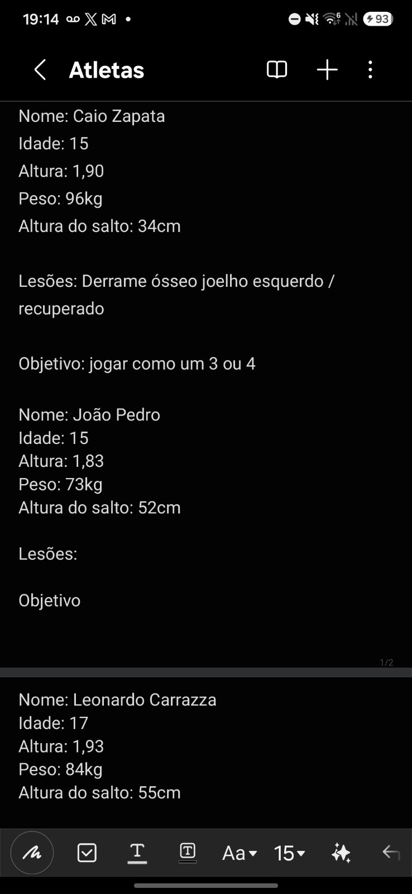
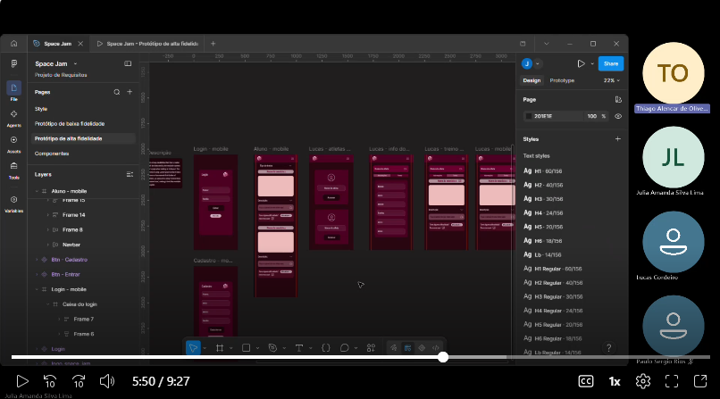
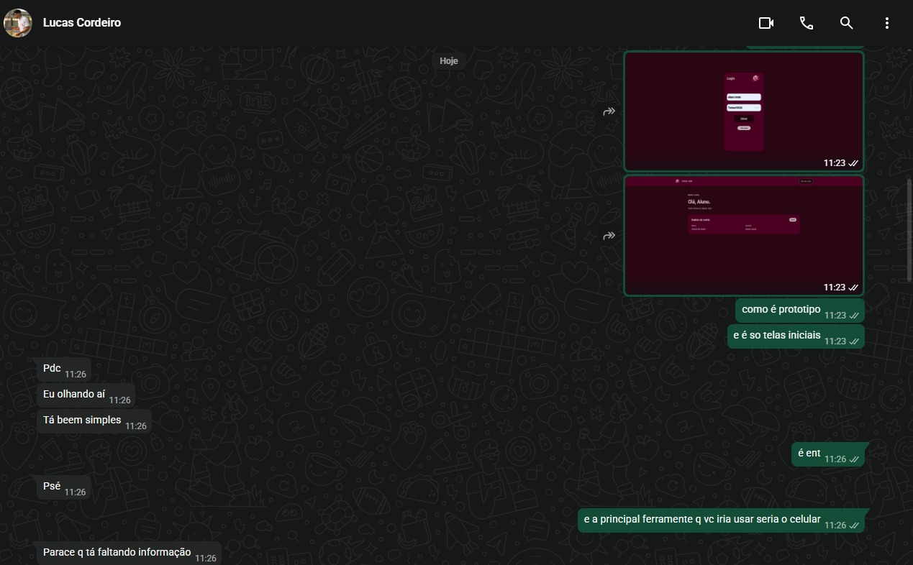

# Reuniões

Esta página reúne as atas das reuniões do projeto Space Jam e as evidências das técnicas de Engenharia de Software e Engenharia de Requisitos aplicadas ao longo do ciclo. Os encaminhamentos e as pendências refletem a situação registrada em cada encontro.

## Registros

As atas preservam discussões e encaminhamentos da data de cada encontro. Para consultar o escopo mantido nesta versão, use o [catálogo](requisitos.md); para entender mudanças posteriores, consulte o [histórico do Backlog](backlog.md#historico-de-revisao).

| Data | Encontro | Ata ou registro |
| --- | --- | --- |
| 14/09/2026 | Reunião da equipe | [Consultar ata](atas/2026-09-14-equipe.md) |
| 17/09/2026 | Reunião com Lucas | [Consultar ata](atas/2026-09-17-lucas.md) |
| 21/09/2026 | Reunião da equipe | [Consultar ata](atas/2026-09-21-equipe.md) |
| 21/09/2026 | Reunião com o monitor Heitor | [Consultar ata](atas/2026-09-21-monitor.md) |
| 26/09/2026 | Reunião com Lucas | [Consultar ata](atas/2026-09-26-lucas.md) |
| 28/09/2026 | Reunião da equipe | [Consultar ata](atas/2026-09-28-equipe.md) |
| 05/10/2026 | Reunião da equipe | [Consultar ata](atas/2026-10-05-equipe.md) |
| 08/10/2026 | Reunião com Lucas | [Consultar ata](atas/2026-10-08-lucas.md) |
| 16/11/2026 | Reunião da equipe | [Consultar registro de consulta](#reuniao-equipe-2026-11-16) |

## Reunião da equipe — 16/11/2026 {#reuniao-equipe-2026-11-16}

**Natureza:** registro de consulta preparado em 16/11/2026 a partir da transcrição automática. Não foi localizada uma ata formal dessa ocorrência; este registro não constitui ata aprovada pela equipe.

**Fonte:** gravação da Reunião Semanal, iniciada às 10h35, com duração de 47min04s e falas transcritas até 47:01. A transcrição não foi integralmente conferida pelo áudio. A fonte integral tem acesso institucional restrito; abaixo estão os encaminhamentos pertinentes à [aplicação do DoR/DoD](aplicacao_dor_dod.md#fonte-reuniao).

| Minutagem | Encaminhamento identificado | Alcance da evidência |
| --- | --- | --- |
| 35:16 | Júlia relata que Luiz adiantou o frontend de US01–US05, referentes a cadastro, login e logout. | Identifica contribuição executada; não comprova atribuição formal anterior ou conclusão das histórias. |
| 35:32 | Júlia relata interfaces e validações preparadas, com integração ao backend e ajustes de requisitos ainda pendentes. | Registra o andamento informado naquele encontro. |
| 35:41–35:44 | Guilherme informa que fará o backend; Thiago comenta a continuidade das frentes de implementação. | Não individualiza a responsabilidade de backend de cada US. |
| 44:17 | Guilherme identifica login e cadastro como sua parte e menciona as chamadas aos endpoints. | Delimita o escopo relatado, sem comprovar atendimento dos aceites ou integração. |
| 45:28 | Thiago orienta Luiz a revisar e Guilherme a prosseguir, mantendo a comunicação. | Comprova encaminhamento de continuidade; não registra a decisão coletiva original de iniciar as oito histórias. |

A tabela acima resume os encaminhamentos; os excertos literais estão no bloco abaixo. Essas falas não demonstram estimativas de esforço nem compatibilidade com a disponibilidade da iteração. A [conferência da Iteração 1](aplicacao_dor_dod.md#conferencia-iteracao1) mantém esses pontos pendentes.

Ver trechos da transcrição usados no DoR/DoD

Excertos da transcrição automática, reproduzidos sem corrigir a redação. A seleção contém somente as falas de projeto utilizadas nesta conferência; não representa a reunião integral nem substitui uma ata aprovada. Não houve validação integral pelo áudio.

O DOCX agrupa falas consecutivas de um participante. No bloco da Júlia iniciado às **34:50**, a passagem sobre US01–US05 foi localizada às **35:16** no Teams; as duas referências foram preservadas.

**Julia Amanda Silva Lima — 34:50 no DOCX**

> Aí do front, eu acho que o que o Luiz falou no chat.o ele tá você não consegue ver né Ó Thiaguinho ele adiantou as Oeste 01 a 05 que envolvem cadastro login de aluno e treinador além do logout

**Julia Amanda Silva Lima — 35:32 no DOCX**

> Já tem interfaces, validações e algumas funcionalidades implementadas e testadas, mas ainda faltam integrações com o back-end e alguns ajustes nos requisitos.

**Guilherme Ferreira Mendes — 35:41 no DOCX**

> Eu vou fazer o backend agorinha.

**Thiago Alencar de Oliveira — 35:44 no DOCX**

> Perfeito. O Guilherme está terminando essa parte do backend. Eu também vou terminar minha parte e.

**Guilherme Ferreira Mendes — 44:17 no DOCX**

> mas a parte do a página do meu código é de boa só login cadastro cara só ver os endpoints certinho as chamadas

**Thiago Alencar de Oliveira — 45:28 no DOCX**

> Isso e aí vocês vocês dão uma revisada lá também. Na verdade, o Luiz dá uma revisada e tu pode seguir o Guilherme, porque aí está de boa. Mas é isso, vamos continuar mantendo a comunicação a gente.

A exportação oficial consultada tem SHA-256 `ccc86925d2ff53a378978ad496268c887743c9d61c04907381c6b7ce4dc6e359`. O arquivo integral e a gravação não foram incorporados à documentação pública.

---

## Evidências de ESW e ER

### 1. Análise documental dos registros do treinador

Durante a fase de Planejamento de Requisitos, a equipe examinou os artefatos utilizados pelo treinador Lucas Cordeiro em sua rotina atual: **fichas individuais no Samsung Notes**, **documentos de planejamento de treino no Microsoft Word** e **anotações rápidas em caderno físico**.

*Figura 1 — Registro real utilizado pelo treinador no Samsung Notes para controle de dados biométricos, lesões e objetivos dos atletas.*

#### Síntese dos documentos examinados e regras/requisitos extraídos

| Documento / Artefato Examinado | Informações Observadas no Documento | Regras de Negócio e Requisitos Derivados |
| :--- | :--- | :--- |
| **Samsung Notes — Nota "Atletas"** | Registros em texto livre contendo: **Nome** (*Caio Zapata*, *João Pedro*, *Leonardo Carrazza*), **Idade** (*15* e *17 anos*), **Altura** (*1,83m* a *1,93m*), **Peso** (*73kg* a *96kg*), **Altura do salto** (*34cm*, *52cm*, *55cm*), **Lesões** (*"Derrame ósseo joelho esquerdo / recuperado"* ou campo vazio) e **Objetivo** (*"jogar como um 3 ou 4"* ou campo vazio). | **1. Estruturação cadastral e biométrica:** fundamenta os campos obrigatórios e opcionais do perfil do atleta (`RF01104`, `RN02`) e valida a necessidade futura de métricas específicas como salto vertical (`RF1216`). **2. Segregação de edição clínica/tática:** evidencia que dados pessoais básicos convivem com informações clínicas (*lesões*) e diretrizes técnicas (*posição/objetivo*), originando a regra que permite ao atleta editar seus dados básicos, mas restringe a edição de histórico clínico e objetivos táticos exclusivamente ao treinador vinculado (`RN01`, `RN02`). **3. LGPD e menores de idade:** a presença de atletas com **15 e 17 anos** comprova o atendimento a menores de 18 anos, exigindo consentimento legal do responsável e isolamento estrito de acesso (`RF4813`, `RNF05`, `RNF10`, `RN15`, `RN16`). **4. Tratamento de campos incompletos:** notas sem lesões ou objetivos preenchidos (ex.: *João Pedro* e *Leonardo Carrazza*) motivaram a definição de campos opcionais no cadastro inicial sem bloquear a criação da ficha. |
| **Documentos Microsoft Word** | Planejamentos de sessões de treino e sequências de exercícios organizados por atleta em arquivos separados. | **1. Biblioteca e prescrição estruturada:** origina o cadastro padronizado de exercícios (`RF02412`, `RF02413`) e a montagem de treinos individualizados vinculados ao atleta (`RF2307`), eliminando a duplicação manual de arquivos. **2. Histórico longitudinal:** motiva a consulta cronológica de treinos prescritos e concluídos (`RNF10`, `RNF12`). |
| **Caderno físico de quadra** | Anotações pontuais de execução, correções técnicas e resultados imediatos coletados durante os treinos presenciais. | **1. Rastreabilidade de execução e feedback:** sustenta o registro de status de conclusão, percepção de dificuldade (`1–5`), envio de vídeo de execução (`RF3501`) e feedback avaliativo privado vinculado (`RF3604`), evitando perda de histórico entre aulas. |

---

### 2. Análise de tarefas (Cenário Atual vs. Cenário Futuro)

Com base no diagnóstico levantado com o treinador Lucas Cordeiro (registrado no [Cenário Atual](cenario_atual.md)) e na modelagem da aplicação Web **Space Jam**, apresenta-se a análise comparativa de como **Treinador** e **Atletas** executam suas principais atividades, detalhando **passos, decisões, dificuldades e exceções**.

> **Nota metodológica:** As tarefas do perfil **Atleta** no cenário atual foram mapeadas a partir do relato operacional do treinador sobre a rotina compartilhada. Como ainda não houve sessão de validação direta com os atletas, os passos e dificuldades previstos para o cenário futuro serão confrontados diretamente com os alunos na etapa de validação de usabilidade.

#### 2.1 Cenário Atual (Rotina presencial e ferramentas dispersas)

| Ator | Tarefa Principal | Passos Executados | Decisões Tomadas | Dificuldades Encontradas | Exceções e Contornos |
| :--- | :--- | :--- | :--- | :--- | :--- |
| **Treinador (Lucas)** | **1. Cadastrar e atualizar perfil/evolução do atleta** | 1. Coleta dados iniciais via WhatsApp ou conversa em quadra. 2. Abre o Samsung Notes no celular e cria/edita um bloco de texto com medidas, lesões e objetivos. 3. Anota resultados de testes em caderno ou notas separadas. | Decidir quais métricas registrar para cada atleta e quando atualizar o status de recuperação de lesão. | Informações espalhadas entre Samsung Notes, Word e caderno; ausência de histórico temporal (novos valores sobrescrevem antigos); dificuldade para comparar evolução. | Campos como *Lesões* ou *Objetivo* ficam em branco quando não há informação no momento; ausência de termo formal de consentimento para menores. |
| **Treinador (Lucas)** | **2. Planejar e prescrever treinos individuais** | 1. Consulta manualmente as anotações do atleta no Samsung Notes. 2. Abre um documento no Word para montar a lista de exercícios. 3. Demonstra os exercícios presencialmente em quadra ou envia orientações por mensagem. | Definir carga, fundamentos e adaptações conforme histórico de lesões e posição desejada (ex.: ala/pivô — posições 3 ou 4). | Retrabalho para reescrever exercícios recorrentes; falta de padronização na descrição de pontos de atenção e erros comuns. | Alterações de última hora no treino por limitação física ou falta de espaço/equipamento em quadra exigem ajuste verbal sem registro no Word. |
| **Treinador (Lucas)** | **3. Avaliar execução e fornecer feedback** | 1. Observa a execução presencialmente durante a aula ou recebe vídeos soltos pelo WhatsApp. 2. Analisa a postura/mecânica do movimento. 3. Responde com correções verbais em quadra ou áudios/mensagens no WhatsApp. | Decidir se o atleta pode avançar de exercício ou precisa repetir/corrigir o movimento. | Vídeos se perdem no histórico de conversas do WhatsApp; falta de vínculo direto entre o exercício prescrito, o vídeo enviado e a correção feita. | Quando não há tempo hábil ou espaço para filmagem presencial, o feedback fica restrito à observação imediata sem registro posterior. |
| **Atleta** | **4. Consultar treino e registrar execução/dúvidas** | 1. Recebe orientações presencialmente ou por mensagens no WhatsApp. 2. Executa os exercícios em quadra ou por conta própria. 3. Grava vídeo pelo celular (quando solicitado) e envia via WhatsApp. | Decidir qual tentativa gravar e enviar ao treinador para avaliação. | Dificuldade para localizar prescrições antigas no chat; falta de referência visual padronizada (vídeo-base e erros comuns) fora do horário de aula. | Em caso de dor, fadiga ou falta de estrutura fora da aula presencial, o atleta interrompe o exercício e avisa informalmente pelo WhatsApp. |

#### 2.2 Cenário Futuro (Aplicação Web Space Jam)

| Ator | Tarefa Principal | Passos na Aplicação Web | Decisões no Fluxo | Dificuldades Mitigadas | Exceções Tratadas pelo Sistema |
| :--- | :--- | :--- | :--- | :--- | :--- |
| **Treinador (Lucas)** | **1. Gerenciar carteira e ficha técnica de atletas** | 1. Acessa a plataforma (após aprovação cadastral pelo Administrador) e gera um **Código de Convite Privado**. 2. Compartilha o código com o atleta para estabelecer vínculo ativo. 3. Consulta dados biométricos preenchidos pelo atleta e registra histórico de lesões e objetivos táticos. | Validar se o consentimento legal do responsável está ativo (para menores de 18 anos) e definir diretrizes clínicas/táticas do aluno. | Centraliza dados cadastrais, biométricos e clínicos em registro único com isolamento por vínculo (`RBAC`), eliminando notas dispersas. | **Convite expirado/inválido:** bloqueio de vínculo. **Menor sem consentimento:** acesso restringido até validação do responsável (`RF4813`). **Inativação de aluno:** preserva histórico sem excluir registros (`RF01105`). |
| **Treinador (Lucas)** | **2. Estruturar biblioteca e prescrever treinos** | 1. Cadastra exercícios na **Biblioteca** com vídeo-base, thumbnail, descrição e erros comuns. 2. Seleciona um atleta vinculado e cria um planejamento/treino individualizado associando exercícios. 3. Disponibiliza o treino no painel do atleta. | Selecionar exercícios adequados aos objetivos e restrições clínicas do atleta; ajustar treinos conforme evolução. | Elimina reescrita no Word e padroniza a explicação técnica e os pontos de atenção dos exercícios. | **Edição após execução:** preserva registros históricos já concluídos pelo atleta. |
| **Treinador (Lucas)** | **3. Avaliar vídeos e registrar feedback privado** | 1. Recebe notificação de vídeo enviado pelo atleta vinculado. 2. Assiste ao vídeo diretamente no contexto do exercício prescrito. 3. Registra feedback avaliativo privado e define status (aprovado ou *Corrigir/Refazer*). | Decidir se a execução atende ao critério técnico ou exige nova gravação. | Garante vínculo permanente entre exercício, vídeo enviado e feedback, com privacidade garantida entre treinador e atleta. | **Imutabilidade pós-feedback:** após o treinador registrar o feedback, o vídeo torna-se imutável (`RF3502`, `RF3604`), impedindo exclusão ou substituição retroativa. |
| **Atleta** | **4. Executar treino, enviar vídeo e acompanhar feedback** | 1. Cadastra-se via **Código de Convite Privado**, aceita termos de uso e atualiza dados pessoais/biométricos. 2. Consulta o treino prescrito e visualiza vídeo-base e erros comuns. 3. Marca exercícios como *Concluído*, informa dificuldade (`1–5`), relato textual e envia vídeo (`.mp4`/`.mov`, até 60s / 100MB). 4. Consulta o feedback privado do treinador. | Avaliar dificuldade percebida (`1–5`), decidir se substitui o vídeo antes da avaliação e revisar execução caso receba status *Corrigir/Refazer*. | Acesso móvel centralizado (Chrome/Safari) com referência visual clara do exercício e histórico organizado de feedbacks. | **Substituição de vídeo:** permitida apenas enquanto não houver feedback registrado. **Arquivo fora do padrão:** rejeição automática de formato inválido, duração > 60s ou tamanho > 100MB (`RNF06`, `RNF14`). |

---

### 3. Modelagem complementar: Matriz Consolidada de Permissões e Acessos

Para encerrar as dúvidas levantadas nas reuniões de **26/09/2026** e **08/10/2026** sobre controle de acesso, visibilidade de dados e consentimento de menores de idade, a equipe consolidou a modelagem de autorização baseada em papéis (**RBAC**) e isolamento multi-inquilino (**Data Isolation**):

* **Artefato consolidado:** [Matriz Consolidada de Permissões e Acessos por Perfil (Google Docs)](https://docs.google.com/document/d/1_6J8LWkFLCoRqjBAPhsyps4IfjCPU20Rf6IHtn7pYzM/edit?tab=t.0#heading=h.scqgboim3nm1)
* **Decisões formalizadas:**
  * Separação explícita entre **Atleta (Próprio)**, **Atleta (Terceiros)**, **Treinador (Vinculado)**, **Treinador (Não Vinculado)** e **Administrador**;
  * Bloqueio total (`HTTP 403/404`) de acesso cruzado entre atletas ou por treinadores sem vínculo ativo via Código de Convite Privado;
  * Edição de dados pessoais/biométricos básicos restrita ao próprio atleta, enquanto dados clínicos (lesões) e táticos ficam em modo somente leitura para o atleta e editáveis apenas pelo treinador vinculado;
  * Imutabilidade de vídeos após o registro de feedback avaliativo e exigência de consentimento legal para atletas menores de 18 anos.

---

### 4. Protótipo de alta fidelidade e fluxos de interação navegáveis

No dia 31 de outubro foi realizado uma reunião com o Lucas para validar o protótipo de alta fidelidade. 

[Assistir à gravação da reunião](https://teams.microsoft.com/l/meetingrecap?driveId=b%218yflCIcNW0a2rV5Uzn_iiLDK00RBOotClfNoAKd0gslYYkODNZ_wQYoFyAoacbpV&driveItemId=01XGJQ4C3TDMCA2NRNEVA2ZN722QEI3MPD&sitePath=https%3A%2F%2Funbbr.sharepoint.com%2Fsites%2FSpaceJam-Requisitos%2FDocumentos+Compartilhados%2FGeneral%2FRecordings%2FReuni%C3%A3o+com+Lucas-20261031_190507-Grava%C3%A7%C3%A3o+de+Reuni%C3%A3o.mp4%3Fweb%3D1&fileUrl=https%3A%2F%2Funbbr.sharepoint.com%2Fsites%2FSpaceJam-Requisitos%2FDocumentos+Compartilhados%2FGeneral%2FRecordings%2FReuni%C3%A3o+com+Lucas-20261031_190507-Grava%C3%A7%C3%A3o+de+Reuni%C3%A3o.mp4%3Fweb%3D1&threadId=19%3AeA1GzX5VWGlKX1CizuHjNRpc6ii12B8JRQdMtd36U9E1%40thread.tacv2&organizerId=3c3e99c1-8904-4b8c-92c2-a6ba66ffa9f6&tenantId=ec359ba1-630b-4d2b-b833-c8e6d48f8059&callId=49b4f240-a546-4c9e-ab30-5951124015ab&threadType=space&meetingType=MeetNow&organizerGroupId=17da893d-773d-4d5d-b685-d5fa59cf1d9a&channelType=Standard&replyChainId=1793483970000&subType=RecapSharingLink_RecapCore&recapType=RecordingAndTranscript)

Foram apresentados os fluxos mais genéricos:

- **Como atleta**: Logar como atleta abriria a tela com o próprio treinamento, ele teria a opção de selecionar o tipo de treino, arremesso, drible, por exemplo, como foi mencionado no feedback do protótipo de baixa fidelidade. Estaria visível as opções: enviar vídeo, selecionar a dificuldade que teve com o exercício e escrever essas dificuldades caso necessário.

- **Como treinador**: Logar como treinador abriria uma página que mostra todos seus alunos ativos, ele poderá acessar o perfil de cada aluno e verificar as informações (testes físicos, nome, idade e etc) e, em outra aba, modificar os treinos.

#### Feeback do Lucas

Está disponível na gravação da reunião, mas em geral foi: "É, primeiro eu gostei da cor, ficou bem legal e as informações estão bem organizadinhas, eu acho que tipo. Depois que abre, eu acho que fica bem bem explicativo para a pessoa entender esse caramba aqui é o vídeo, é aqui que eu coloco o feedback, é aqui onde eu coloco a dificuldade e tals, tá ligado? Eu acho que ficou bom por causa disso, é mais pela organização e tipo, não simplicidade, mas tipo, é fácil de entender, tá ligado? Que que tem, que que precisa ser feito? [...] por mim pode manter o jeito que estiver mesmo, que está pra mim assim está bom."

[Abrir protótipo interativo de alta fidelidade no Figma](https://www.figma.com/design/HJ5ukxYtbpQDmzD2OO7Jw3/Space-Jam?node-id=168-1123&t=A0Cp6Y2IzX1Yzgec-0)

  
Visualizar protótipo navegável de alta fidelidade nesta página

  

    <iframe
      src="https://embed.figma.com/design/HJ5ukxYtbpQDmzD2OO7Jw3/Space-Jam?node-id=168-1123&embed-host=share"
      title="Protótipo de alta fidelidade navegável do Space Jam no Figma"
      loading="lazy"
      allowfullscreen>
    </iframe>
  

#### Justificativa metodológica (substituição do diagrama formal pelo fluxo navegável)

- **Distinção conceitual:** um diagrama formal de interação (como diagramas de sequência ou de atividades) modela a troca estática de mensagens e regras de controle entre componentes, enquanto um **fluxo de interação navegável** representa a transição dinâmica entre telas, botões e estados sob a perspectiva de uso.
- **Opção adotada pela equipe:** alinhada à abordagem iterativa do **RAD (Rapid Application Development)**, a equipe optou por **não confeccionar diagramas estáticos separados de fluxo de interação**, substituindo-os diretamente pelo protótipo navegável de alta fidelidade no Figma.
- **Cobertura funcional:** o protótipo permite percorrer ponta a ponta os fluxos do treinador e do atleta (autenticação, gestão de perfil e métricas, biblioteca de exercícios, montagem de treinos, envio de vídeos e registro de feedback), cumprindo o objetivo de comunicar e validar os fluxos operacionais antes e durante a construção.

#### Atualização

No dia 16 de novembro, apesar do protótipo de alta fidelidade ter sido validado, foi mandado um print para o Lucas de como estaria o andamento das implementações e ele o achou simples, então talvez vamos mudar o protótipo de alta fidelidade e o front na próxima iteração.

---

### 5. Consolidação da Revisão por Pares e Encerramento dos RNFs

> **Status:** Rodada de revisão por pares concluída sobre os artefatos de requisitos (RNFs, critérios de aceitação e matriz de permissões), o incremento de acesso e cadastro no frontend (`US01`–`US05`) e a auditoria técnica do módulo de biblioteca de exercícios no backend (`CP4` / `US20`–`US25`), consolidando as correções aplicadas, pendências de integração e melhorias mapeadas para os próximos incrementos.

| ID / Artefato Revisado | Problema ou Ambiguidade Identificada | Decisão e Correção Aplicada | Responsável / Revisor | Status |
| :--- | :--- | :--- | :--- | :--- |
| **RNFs de Acesso, Visibilidade e Consentimento (`RNF05`, `RNF09`–`RNF17`)** | Pendências abertas nas atas de 26/09 e 08/10 sobre quem edita dados clínicos, visibilidade de vídeos/feedbacks e tratamento de menores. | Consolidado na [Matriz Consolidada de Permissões e Acessos por Perfil](https://docs.google.com/document/d/1_6J8LWkFLCoRqjBAPhsyps4IfjCPU20Rf6IHtn7pYzM/edit?tab=t.0#heading=h.scqgboim3nm1) com regras explícitas de RBAC, isolamento de dados e consentimento legal. | Equipe Space Jam | Concluído |
| **Pré-Envio de Mídia (`RNF15` × `RNF16`)** | Mistura entre atributos de qualidade operacional/rede (`RNF15`) e comportamento visual de interface/tela (`RNF16`). | Adicionada nota de escopo delimitando que o `RNF15` cobre desempenho local ($\le 1,0\text{ s}$) e zero tráfego antes da confirmação, enquanto interação visual pertence ao `RNF16` e aos CAs. | Anderson Fernandes | Concluído |
| **Frontend `US01` / Cadastro de Aluno (Campo Envergadura)** | O campo solicita o valor em centímetros (`cm`), mas exibe o erro de validação do servidor em metros (`0.5`), além de o termo "envergadura" não ser claro para leigos. | Registrado para traduzir as mensagens de erro para centímetros (`50 cm` a `280 cm`) e adicionar texto explicativo/ajuda visual no campo. | Anderson Fernandes | Pendente (Próximo Incremento) |
| **Frontend `US01`–`US02` / Aceite de Termos (`AceiteTermos.tsx`)** | Quando as URLs dos Termos de Uso e Privacidade não estão configuradas no `.env`, o aceite fica indisponível sem um aspecto visual claro explicando o motivo. | Registrado para exibir estado visual desabilitado com aviso claro informando a indisponibilidade dos documentos oficiais. | Anderson Fernandes | Pendente (Próximo Incremento) |
| **Frontend `US02` / Tela "Minha Conta" (Treinador)** | O código de convite (`TRN-XXXXXX`) aparece apenas imediatamente após o cadastro; ao acessar "Minha Conta", o treinador não consegue mais vê-lo ou copiá-lo. | Registrado para exibir o código de convite com botão de "Copiar" também na tela "Minha Conta" do perfil treinador. | Anderson Fernandes | Pendente (Próximo Incremento) |
| **Frontend `US01` / Consentimento de Menores (`RN16`)** | O bloqueio de menores de 18 anos informa a exigência de consentimento dos pais, mas não oferece meio prático de contato com o treinador ou modelo de autorização. | Registrado para incluir canal direto de contato (WhatsApp/e-mail) ou acesso ao documento padrão de autorização na mensagem de bloqueio. | Anderson Fernandes | Pendente (Próximo Incremento) |
| **Frontend `US01` / Experiência de Cadastro (UX)** | Formulário de aluno concentrado em uma única tela longa, sem ícone para exibir/ocultar senha no cadastro e com digitação livre em objetivos e código do treinador. | Catalogado como melhorias de UX: dividir cadastro em etapas, adicionar botão de visualizar senha, oferecer opções marcáveis de objetivos e suportar link de convite com código automático. | Anderson Fernandes | Catalogado (Backlog UX) |
| **Backend `CP4` / Cadastro e Edição de Exercícios (`US23`–`US25`, `RF02412`)** | O modelo contempla apenas a URL do vídeo (`video_base`), sem campos de título e descrição do vídeo nem obrigatoriedade condicional de `erros_comuns` exigidos pelo `CA01`. | Registrado para incluir metadados do vídeo (`video_titulo`, `video_descricao`), validação condicional quando houver vídeo e alinhamento do campo `objetivo`. | Anderson Fernandes | Pendente (Próximo Incremento) |

#### Pontos Positivos Validados na Revisão do Frontend (`US01`–`US05`)

- **Escopo isolado e qualidade técnica:** Alterações restritas à pasta `frontend/`, com 65 testes unitários/contrato e 8 testes HTTP reais aprovados contra PostgreSQL/Docker, sem erros de lint/build e sem credenciais expostas no código.
- **Validação de segurança de senha:** O sistema bloqueia senhas curtas ou simples demais (ex.: `123456`) e exibe os avisos diretamente nos campos correspondentes.
- **Conformidade legal preventiva (LGPD / `RN16`):** Exige clique explícito para aceitar os termos e bloqueia o cadastro de menores de 18 anos enquanto não houver fluxo comprovável de consentimento dos responsáveis.
- **Fluxo funcional de ponta a ponta:** Cadastro de treinador gera código de convite (`TRN-XXXXXX`) que vincula alunos corretamente, diferencia login por perfil (e-mail para treinador, apelido para aluno), preserva a sessão ao recarregar a página (`F5`) e encerra o acesso ao sair da conta.

#### Pontos Positivos Validados no Backend (`biblioteca-de-exercicios` — `CP4`)

- **Núcleo funcional e testado:** Cadastro, listagem, detalhe e edição de exercícios operacionais para treinador, com `manage.py check` sem problemas e 34 testes automatizados aprovados em container descartável.
- **Integridade de autoria e permissões base:** Campos de auditoria e `criado_por` protegidos como somente leitura no serializer, escrita restrita ao perfil treinador e exclusão bloqueada (HTTP 405) conforme o recorte do MVP.

---

### 6. Reunião de alinhamento com o brainstorm

A captura mostra a apresentação da problemática. A data e a ata correspondente ainda precisam ser identificadas para relacioná-la à atividade registrada.

---

### 7. Apresentação do protótipo inicial

[Abrir o protótipo no Figma](https://www.figma.com/design/HJ5ukxYtbpQDmzD2OO7Jw3/Space-Jam?node-id=31-864)

  
Ver protótipo de baixa fidelidade nesta página

  

    <iframe
      src="https://embed.figma.com/design/HJ5ukxYtbpQDmzD2OO7Jw3/Space-Jam?node-id=31-864&embed-host=share"
      title="Protótipo de baixa fidelidade do Space Jam no Figma"
      loading="lazy"
      allowfullscreen>
    </iframe>
  

O registro abaixo mostra o envio de um vídeo explicativo do protótipo de baixa fidelidade e a reação positiva do treinador Lucas:

{:  width="859" height="298" }

#### Registro da apresentação do protótipo inicial

A equipe encaminhou ao treinador Lucas Cordeiro um vídeo explicativo do protótipo de baixa fidelidade desenvolvido no Figma. A captura da conversa no WhatsApp registra uma reação positiva ao material apresentado.

Entretanto, essa manifestação não constitui, isoladamente, uma validação formal dos fluxos funcionais ou dos critérios de aceitação do produto.

| Campo | Registro |
|---|---|
| Artefato apresentado | Protótipo de baixa fidelidade |
| Ferramenta | Figma |
| Forma de apresentação | Vídeo explicativo encaminhado pelo WhatsApp |
| Participante externo | Lucas Cordeiro |
| Evidência | Captura da conversa |
| Resultado observado | Reação positiva ao material apresentado |
| Fluxos avaliados individualmente | - **Como atleta**: Logar como atleta abriria a tela com o próprio treinamento, ele teria a opção de selecionar o treino atual ou visualizar um treino antigo. Estaria visível as opções: enviar vídeo, selecionar a dificuldade que teve com o exercício e escrever essas dificuldades caso necessário.- **Como treinador**: Logar como treinador abriria uma página que mostra todos seus alunos ativos, ele poderá acessar o perfil de cada aluno e verificar as informações (testes físicos, nome, idade e etc) e, em outra aba, modificar os treinos. |
| Critérios de aceitação verificados | Não documentados |
| Ajustes solicitados pelo cliente | Pediu para que os treinos fossem separados por fundamento |
| Situação | Apresentação registrada; validação detalhada pendente |

A equipe reconhece que a reação positiva não demonstra aprovação integral do protótipo. Para caracterizar a conclusão de uma rodada de validação, serão necessários registros que identifiquem os fluxos avaliados, as observações do treinador, as decisões resultantes e os ajustes aplicados.

### 8. Rastreabilidade dos Ciclos de Prototipação, Avaliação e Refinamento

A metodologia RAD (Rapid Application Development) orienta o desenvolvimento incremental do Space Jam, por meio de ciclos de prototipação, avaliação e refinamento da solução.

Para demonstrar a aplicação dessa abordagem, a equipe relaciona os artefatos apresentados, os registros de avaliação, as decisões tomadas e os ajustes realizados. Essa rastreabilidade permite distinguir atividades concluídas, refinamentos em andamento e validações ainda pendentes.

#### 8.1 Registro das etapas de prototipação e refinamento

| Etapa | Artefato ou atividade | Evidência disponível | Situação |
|---|---|---|---|
| Prototipação inicial | Protótipo de baixa fidelidade | [Protótipo no Figma](https://www.figma.com/design/HJ5ukxYtbpQDmzD2OO7Jw3/Space-Jam?node-id=31-864) e registro de envio pelo WhatsApp | Apresentação documentada; avaliação detalhada pendente |
| Refinamento dos requisitos | Discussões sobre permissões, visibilidade de informações e consentimento | [Ata de 26/09](atas/2026-09-26-lucas.md), [ata de 08/10](atas/2026-10-08-lucas.md) e matriz de permissões | Decisões documentadas; vínculo com alterações do protótipo a complementar |
| Prototipação de alta fidelidade | Protótipo navegável com fluxos do treinador e atleta | [Protótipo de alta fidelidade](https://www.figma.com/design/HJ5ukxYtbpQDmzD2OO7Jw3/Space-Jam?node-id=168-1123) | Artefato disponível; avaliação formal a identificar |
| Revisão técnica | Revisão dos requisitos e incrementos de frontend e backend | [Revisão por pares](#revisao-por-pares) | Correções e pendências registradas |
| Construção incremental | Implementação de funcionalidades de cadastro, autenticação e biblioteca de exercícios | [Registro de 16/11](#reuniao-equipe-2026-11-16) e revisão por pares | Implementação parcial documentada |

#### 8.2 Rastreabilidade das mudanças entre versões

Para caracterizar uma rodada completa de RAD, cada ciclo deverá relacionar:

1. A versão do protótipo ou incremento apresentada.
2. Os fluxos e critérios efetivamente avaliados.
3. O feedback recebido do treinador.
4. As decisões de manutenção ou alteração.
5. Os ajustes realizados e suas evidências.
6. A versão revisada resultante.

| Rodada | Versão apresentada | Avaliação recebida | Ajustes realizados | Versão revisada | Situação |
|---|---|---|---|---|---|
| Prototipação inicial | Protótipo de baixa fidelidade | Reação positiva registrada no WhatsApp, sem critérios específicos documentados | Não identificados na evidência disponível | Protótipo de alta fidelidade disponível, sem vínculo causal comprovado com o feedback | Rastreabilidade incompleta |
| Refinamento de permissões | Requisitos e regras discutidos com Lucas | Dúvidas sobre visibilidade, edição e acesso aos dados | Consolidação das regras na matriz de permissões | Matriz consolidada de permissões e acessos | Refinamento de requisitos documentado; alteração correspondente no protótipo a identificar |
| Revisão técnica | Incrementos de cadastro, autenticação e biblioteca de exercícios | Problemas e melhorias identificados na revisão por pares | Correções e pendências registradas | Novas versões de implementação ainda precisam ser vinculadas às correções | Refinamento técnico parcialmente documentado |

A existência de versões de protótipos, reuniões e registros de revisão não é considerada, isoladamente, comprovação de ciclos completos de RAD. As relações entre feedback, modificação e nova versão serão registradas conforme as evidências forem identificadas.

#### 8.3 Estratégia de validação

A validação do produto durante esta etapa será realizada diretamente com Lucas Cordeiro, treinador e cliente do projeto.

Os atletas permanecem como usuários finais previstos, mas não participarão diretamente dos testes e das atividades de validação da equipe. As necessidades e os fluxos destinados a esse perfil serão avaliados a partir da perspectiva de Lucas.

Essa estratégia permite realizar o refinamento junto ao especialista do domínio, mas apresenta como limitação a ausência de avaliação direta da usabilidade pelos atletas.

As decisões resultantes das avaliações com Lucas deverão ser registradas nas atas e vinculadas às alterações realizadas no protótipo ou na implementação.

---

## Registros complementares de outubro e novembro

Os documentos abaixo complementam as atas anteriores. As sínteses mantêm os encaminhamentos de cada encontro; os registros sem conteúdo recuperado identificam somente a realização da chamada.

| Data | Encontro | Ata ou registro |
| --- | --- | --- |
| 07/10/2026 | Chamada da equipe no canal Geral | [Consultar registro](atas/2026-10-07-equipe.md) |
| 12/10/2026 | Reunião semanal da equipe | [Consultar ata](atas/2026-10-12-equipe.md) |
| 12–13/10/2026 | Preparação e gravação das apresentações | [Consultar registro](atas/2026-10-12-13-apresentacoes.md) |
| 15/10/2026 | Reunião com Lucas | [Consultar ata](atas/2026-10-15-lucas.md) |
| 31/10/2026 | Reunião com Lucas | [Consultar ata](atas/2026-10-31-lucas.md) |
| 09/11/2026 | Chamadas da equipe no canal Geral | [Consultar registro](atas/2026-11-09-equipe.md) |
| 16/11/2026 | Reunião semanal da equipe | [Consultar registro existente no PR #74](https://github.com/mdsreq-fga-unb/REQ-2026.2-T01-SpaceJam/blob/8c314a0a229de565583c61e2887e297b0171642e/docs/reunioes.md#L22) |

O registro de consulta de 16/11 integra a documentação de aplicação do DoR/DoD no [PR #74](https://github.com/mdsreq-fga-unb/REQ-2026.2-T01-SpaceJam/pull/74). A referência acima permite consultá-lo na versão identificada, sem reproduzir seu conteúdo.

??? abstract "Histórico de revisão"

    | Data | Versão | Descrição | Autor |
    | --- | --- | --- | --- |
    | 16/11/2026 | 0.5 | Inclusão do registro de consulta da reunião de 16/11, com fonte, minutagens e limites da evidência; sem ata formal identificada. | Luiz Henrique Pessato da Mota |
    | 16/11/2026 | 0.6 | Inclusão das evidências de Análise Documental (Samsung Notes, Word e caderno), Análise de Tarefas (Cenário Atual e Cenário Futuro), vínculo da Matriz Consolidada de Permissões e estrutura da Revisão por Pares. | Equipe Space Jam |
    | 10/10/2026 | 0.4 | Registro das minutagens para consulta dos trechos relevantes. | Equipe Space Jam |
    | 10/10/2026 | 0.3 | Inclusão das atas disponíveis da equipe, do cliente e do monitor. | Equipe Space Jam |
    | 10/10/2026 | 0.2 | Preparação das atas de 17/09 e 08/10 e do registro parcial de 05/10. | Equipe Space Jam |
    | 14/09/2026 | 0.1 | Criação da página destinada ao registro das reuniões do projeto. | Equipe Space Jam |