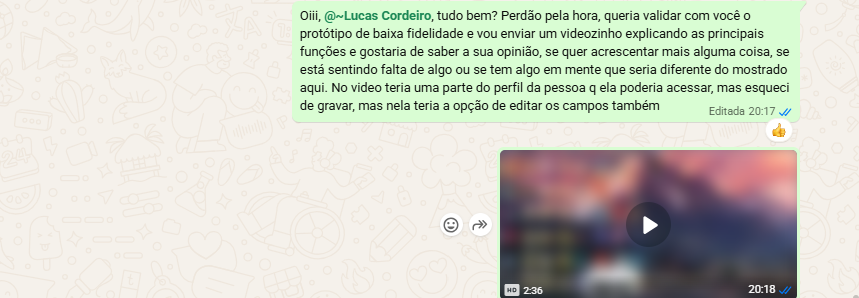

# Reuniões

Esta página reúne as atas e os registros de consulta das reuniões do projeto Space Jam. Os encaminhamentos e as pendências refletem a situação em cada encontro.

## Registros

As atas preservam discussões e encaminhamentos da data de cada encontro. Para consultar o escopo mantido nesta versão, use o [catálogo](requisitos.md); para entender mudanças posteriores, consulte o [histórico do Backlog](backlog.md#historico-de-revisao).

| Data | Encontro | Ata ou registro |
| --- | --- | --- |
| 14/09/2026 | Reunião da equipe | [Consultar ata](atas/2026-09-14-equipe.md) |
| 17/09/2026 | Reunião com Lucas | [Consultar ata](atas/2026-09-17-lucas.md) |
| 21/09/2026 | Reunião da equipe | [Consultar ata](atas/2026-09-21-equipe.md) |
| 21/09/2026 | Reunião com o monitor Heitor | [Consultar ata](atas/2026-09-21-monitor.md) |
| 26/09/2026 | Reunião com Lucas | [Consultar ata](atas/2026-09-26-lucas.md) |
| 28/09/2026 | Reunião da equipe | [Consultar ata](atas/2026-09-28-equipe.md) |
| 05/10/2026 | Reunião da equipe | [Consultar ata](atas/2026-10-05-equipe.md) |
| 08/10/2026 | Reunião com Lucas | [Consultar ata](atas/2026-10-08-lucas.md) |
| 16/11/2026 | Reunião da equipe | [Consultar registro de consulta](#reuniao-equipe-2026-11-16) |

## Reunião da equipe — 16/11/2026 {#reuniao-equipe-2026-11-16}

**Natureza:** registro de consulta preparado em 16/11/2026 a partir da transcrição automática. Não foi localizada uma ata formal dessa ocorrência; este registro não constitui ata aprovada pela equipe.

**Fonte:** gravação da Reunião Semanal, iniciada às 10h35, com duração de 47min04s e falas transcritas até 47:01. A transcrição não foi integralmente conferida pelo áudio. A fonte integral tem acesso institucional restrito; abaixo estão os encaminhamentos pertinentes à [aplicação do DoR/DoD](aplicacao_dor_dod.md#fonte-reuniao).

| Minutagem | Encaminhamento identificado | Alcance da evidência |
| --- | --- | --- |
| 35:16 | Júlia relata que Luiz adiantou o frontend de US01–US05, referentes a cadastro, login e logout. | Identifica contribuição executada; não comprova atribuição formal anterior ou conclusão das histórias. |
| 35:32 | Júlia relata interfaces e validações preparadas, com integração ao backend e ajustes de requisitos ainda pendentes. | Registra o andamento informado naquele encontro. |
| 35:41–35:44 | Guilherme informa que fará o backend; Thiago comenta a continuidade das frentes de implementação. | Não individualiza a responsabilidade de backend de cada US. |
| 44:17 | Guilherme identifica login e cadastro como sua parte e menciona as chamadas aos endpoints. | Delimita o escopo relatado, sem comprovar atendimento dos aceites ou integração. |
| 45:28 | Thiago orienta Luiz a revisar e Guilherme a prosseguir, mantendo a comunicação. | Comprova encaminhamento de continuidade; não registra a decisão coletiva original de iniciar as oito histórias. |

A tabela acima resume os encaminhamentos; os excertos literais estão no bloco abaixo. Essas falas não demonstram estimativas de esforço nem compatibilidade com a disponibilidade da iteração. A [conferência da Iteração 1](aplicacao_dor_dod.md#conferencia-iteracao1) mantém esses pontos pendentes.

Ver trechos da transcrição usados no DoR/DoD

Excertos da transcrição automática, reproduzidos sem corrigir a redação. A seleção contém somente as falas de projeto utilizadas nesta conferência; não representa a reunião integral nem substitui uma ata aprovada. Não houve validação integral pelo áudio.

O DOCX agrupa falas consecutivas de um participante. No bloco da Júlia iniciado às **34:50**, a passagem sobre US01–US05 foi localizada às **35:16** no Teams; as duas referências foram preservadas.

**Julia Amanda Silva Lima — 34:50 no DOCX**

> Aí do front, eu acho que o que o Luiz falou no chat.o ele tá você não consegue ver né Ó Thiaguinho ele adiantou as Oeste 01 a 05 que envolvem cadastro login de aluno e treinador além do logout

**Julia Amanda Silva Lima — 35:32 no DOCX**

> Já tem interfaces, validações e algumas funcionalidades implementadas e testadas, mas ainda faltam integrações com o back-end e alguns ajustes nos requisitos.

**Guilherme Ferreira Mendes — 35:41 no DOCX**

> Eu vou fazer o backend agorinha.

**Thiago Alencar de Oliveira — 35:44 no DOCX**

> Perfeito. O Guilherme está terminando essa parte do backend. Eu também vou terminar minha parte e.

**Guilherme Ferreira Mendes — 44:17 no DOCX**

> mas a parte do a página do meu código é de boa só login cadastro cara só ver os endpoints certinho as chamadas

**Thiago Alencar de Oliveira — 45:28 no DOCX**

> Isso e aí vocês vocês dão uma revisada lá também. Na verdade, o Luiz dá uma revisada e tu pode seguir o Guilherme, porque aí está de boa. Mas é isso, vamos continuar mantendo a comunicação a gente.

A exportação oficial consultada tem SHA-256 `ccc86925d2ff53a378978ad496268c887743c9d61c04907381c6b7ce4dc6e359`. O arquivo integral e a gravação não foram incorporados à documentação pública.

## Evidências de ESW e ER

### Reunião de alinhamento com o brainstorm

{:  width="719" height="396" }

A captura mostra a apresentação da problemática. A data e a ata correspondente ainda precisam ser identificadas para relacioná-la à atividade registrada.

### Apresentação do protótipo inicial

[Abrir o protótipo no Figma](https://www.figma.com/design/HJ5ukxYtbpQDmzD2OO7Jw3/Space-Jam?node-id=31-864)

  
Ver protótipo de baixa fidelidade nesta página

  

    <iframe
      src="https://embed.figma.com/design/HJ5ukxYtbpQDmzD2OO7Jw3/Space-Jam?node-id=31-864&embed-host=share"
      title="Protótipo de baixa fidelidade do Space Jam no Figma"
      loading="lazy"
      allowfullscreen>
    </iframe>
  

O registro abaixo mostra o envio de um vídeo explicativo do protótipo de baixa fidelidade e uma reação positiva à mensagem:

{:  width="859" height="298" }

Para documentar a rodada de validação, ainda é necessário identificar a data, a versão apresentada, os fluxos e critérios avaliados, o retorno recebido e os ajustes decorrentes. O arquivo do Figma acima é uma referência navegável; seu estado atual não identifica, por si só, a versão apresentada nessa conversa.

??? abstract "Histórico de revisão"

    | Data | Versão | Descrição | Autor |
    | --- | --- | --- | --- |
    | 16/11/2026 | 0.5 | Inclusão do registro de consulta da reunião de 16/11, com fonte, minutagens e limites da evidência; sem ata formal identificada. | Luiz Henrique Pessato da Mota |
    | 10/10/2026 | 0.4 | Registro das minutagens para consulta dos trechos relevantes. | Equipe Space Jam |
    | 10/10/2026 | 0.3 | Inclusão das atas disponíveis da equipe, do cliente e do monitor. | Equipe Space Jam |
    | 10/10/2026 | 0.2 | Preparação das atas de 17/09 e 08/10 e do registro parcial de 05/10. | Equipe Space Jam |
    | 14/09/2026 | 0.1 | Criação da página destinada ao registro das reuniões do projeto. | Equipe Space Jam |
