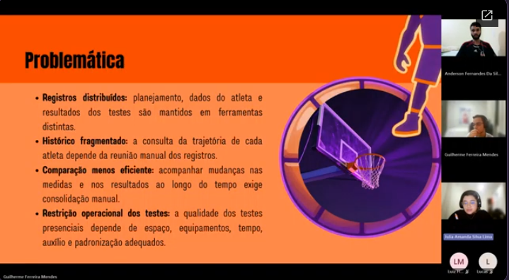

# Reuniões

Esta página reúne as atas das reuniões do projeto Space Jam. Os encaminhamentos e as pendências refletem a situação em cada encontro.

## Registros

As atas preservam discussões e encaminhamentos da data de cada encontro. Para consultar o escopo mantido nesta versão, use o [catálogo](requisitos.md); para entender mudanças posteriores, consulte o [histórico do Backlog](backlog.md#historico-de-revisao).

| Data | Encontro | Ata |
| --- | --- | --- |
| 14/09/2026 | Reunião da equipe | [Consultar ata](atas/2026-09-14-equipe.md) |
| 17/09/2026 | Reunião com Lucas | [Consultar ata](atas/2026-09-17-lucas.md) |
| 21/09/2026 | Reunião da equipe | [Consultar ata](atas/2026-09-21-equipe.md) |
| 21/09/2026 | Reunião com o monitor Heitor | [Consultar ata](atas/2026-09-21-monitor.md) |
| 26/09/2026 | Reunião com Lucas | [Consultar ata](atas/2026-09-26-lucas.md) |
| 28/09/2026 | Reunião da equipe | [Consultar ata](atas/2026-09-28-equipe.md) |
| 05/10/2026 | Reunião da equipe | [Consultar ata](atas/2026-10-05-equipe.md) |
| 08/10/2026 | Reunião com Lucas | [Consultar ata](atas/2026-10-08-lucas.md) |

## Evidências de ESW e ER

### Protótipo de alta fidelidade e fluxos de interação navegáveis

[Abrir protótipo interativo de alta fidelidade no Figma](https://www.figma.com/design/HJ5ukxYtbpQDmzD2OO7Jw3/Space-Jam?node-id=168-1123&t=A0Cp6Y2IzX1Yzgec-0)

  
Visualizar protótipo navegável de alta fidelidade nesta página

  

    <iframe
      src="https://embed.figma.com/design/HJ5ukxYtbpQDmzD2OO7Jw3/Space-Jam?node-id=168-1123&embed-host=share"
      title="Protótipo de alta fidelidade navegável do Space Jam no Figma"
      loading="lazy"
      allowfullscreen>
    </iframe>
  

#### Justificativa metodológica (substituição do diagrama formal pelo fluxo navegável)

- **Distinção conceitual:** um diagrama formal de interação (como diagramas de sequência ou de atividades) representa a troca estática de mensagens e regras de controle entre componentes, enquanto um fluxo de interação navegável representa a transição dinâmica entre telas, botões e estados sob a ótica do usuário.
- **Opção adotada pela equipe:** alinhada à abordagem iterativa do **RAD (Rapid Application Development)**, a equipe optou por **não confeccionar diagramas formais separados de fluxo de interação**, substituindo-os diretamente pela prototipação de alta fidelidade com botões interativos no Figma.
- **Cobertura funcional:** o protótipo navegável permite percorrer ponta a ponta os principais cenários do treinador e do atleta (autenticação, gestão de perfil e métricas, biblioteca de exercícios, montagem de treinos, envio de vídeos e registro de feedback), cumprindo o objetivo de comunicar e validar os fluxos operacionais antes e durante a construção.

### Análise documental: registro pessoal de atleta (Samsung Notes)

Durante a etapa de elicitação, o treinador Lucas compartilhou um exemplo real de como estrutura manualmente as fichas individuais dos seus atletas em suas anotações pessoais no **Samsung Notes**:

> **Exemplo de registro (Samsung Notes):**  
> Nome: Caio Zapata  
> Idade: 15  
> Altura: 1,90  
> Peso: 96kg  
> Altura do salto: 34cm  
> Lesões: Derrame ósseo joelho esquerdo / recuperado  
> Objetivo: jogar como um 3 ou 4

#### Breve análise e impacto nos requisitos

- **Estruturação de dados cadastrais e físicos:** confirma os atributos centrais do perfil do atleta (nome, idade, altura e peso) e valida a necessidade de registro de métricas específicas da modalidade, como a altura do salto (*jump height*), sustentando os requisitos de cadastro e consulta de perfil e testes físicos.
- **Segregação de permissões e visibilidade:** evidencia que a ficha mistura dados pessoais/biométricos básicos com informações clínicas sensíveis (*histórico e status de recuperação de lesões*) e diretrizes técnicas (*objetivos táticos por posição*), fundamentando a regra de negócio que restringe a edição e o gerenciamento clínico/tático ao treinador.
- **Conformidade com a LGPD (menores de idade):** a presença de atletas na faixa etária de 15 anos comprova que o público-alvo inclui menores de idade, reforçando a obrigatoriedade de requisitos não funcionais voltados à proteção de dados pessoais, controle de acesso e consentimento legal.
- **Superação da fragmentação:** demonstra que o acompanhamento atual depende de blocos de texto não estruturados, o que dificulta a comparação histórica da evolução física e tática ao longo do tempo e justifica a centralização proposta pelo Space Jam.

### Análise de tarefas: rotina atual do treinador e dos atletas (Cenário Atual)

Com base no levantamento do cenário atual e nas entrevistas com o treinador Lucas Cordeiro (atas de [17/09/2026](atas/2026-09-17-lucas.md) e [26/09/2026](atas/2026-09-26-lucas.md)), a equipe mapeou como treinador e atletas executam suas atividades atualmente, identificando passos operacionais, pontos de decisão, dificuldades e exceções.

#### 1. Tarefas do Treinador (Lucas Cordeiro)

- **Passos operacionais:**
  1. **Captação e contato inicial:** comunica-se com atletas e responsáveis legais (no caso de menores de idade) via **WhatsApp** e **Instagram** para alinhar horários e objetivos.
  2. **Avaliação física e diagnóstico:** aplica testes físicos e específicos do basquete durante os treinos presenciais (coletando altura, peso, envergadura, *standing reach*, *jump height* e histórico de lesões) e anota os dados manualmente em **caderno físico**, **Samsung Notes** ou documentos no **Word**.
  3. **Planejamento individualizado:** estrutura a rotina de exercícios de cada atleta considerando seus objetivos técnicos/táticos e restrições clínicas, registrando o plano de forma dispersa entre notas e arquivos de texto.
  4. **Condução e correção em quadra:** demonstra os exercícios presencialmente, observa a execução e realiza ajustes imediatos durante a sessão.
  5. **Acompanhamento de evolução:** consulta anotações antigas espalhadas nos três meios para tentar comparar resultados de testes e treinos anteriores.
- **Principais decisões:**
  - Definir quais exercícios e cargas prescrever com base nos objetivos individuais (ex.: posição em quadra), resultados de testes e histórico de lesões.
  - Adaptar o planejamento de treino durante ou após a sessão presencial conforme o desempenho observado.
  - Escolher onde registrar cada informação (caderno durante a quadra, Samsung Notes ou Word posteriormente).
- **Dificuldades e exceções:**
  - **Fragmentação de registros:** como os dados ficam divididos entre caderno, Samsung Notes e Word, localizar informações rápidas e consolidar o histórico evolutivo exige esforço manual e retrabalho.
  - **Restrições ambientais e operacionais nos testes:** a aplicação e a qualidade dos testes físicos dependem de disponibilidade de espaço físico adequado, equipamentos específicos, tempo de sessão, auxílio de terceiros e padronização da coleta.
  - **Ausência de equipe multidisciplinar integrada:** profissionais como fisioterapeutas ou preparadores físicos não participam do fluxo atual, fazendo com que o treinador concentre sozinho o registro de histórico de lesões.

#### 2. Tarefas dos Atletas (e Responsáveis Legais)

*(Nota: no cenário atual, este fluxo reflete a rotina operacional descrita pelo treinador Lucas; a validação direta da perspectiva dos atletas está prevista para as rodadas de testes de usabilidade).*

- **Passos operacionais:**
  1. **Comunicação e agendamento:** interagem com o treinador (diretamente ou por intermédio dos responsáveis legais, no caso de menores de 15 anos) pelo **WhatsApp** e **Instagram**.
  2. **Recebimento de orientações:** recebem instruções verbais durante o treino presencial ou mensagens pontuais sobre exercícios a praticar.
  3. **Execução das atividades:** realizam os exercícios prescritos em quadra sob observação direta do treinador ou praticam individualmente fora do horário presencial.
  4. **Report de dúvidas ou dificuldades:** comunicam desconfortos, lesões ou dificuldades de execução verbalmente em quadra ou por mensagens informais.
- **Principais decisões:**
  - Informar ao treinador limitações físicas, dores ou histórico de lesões antes ou durante o treino.
  - Decidir quando e como solicitar esclarecimentos sobre a execução correta de um fundamento fora do horário presencial.
- **Dificuldades e exceções:**
  - **Dependência da memória após o treino:** sem uma biblioteca centralizada com vídeos-base e erros comuns, o atleta depende de lembrar das demonstrações feitas em quadra.
  - **Falta de visibilidade estruturada da própria evolução:** o atleta não possui acesso organizado ao próprio histórico de planejamentos, metas e resultados de testes físicos registrados pelo treinador.
  - **Mediação de responsáveis (menores de idade):** para atletas menores, o fluxo de comunicação e autorização envolve pais ou tutores legais, exigindo cuidado adicional com privacidade e compartilhamento de dados.

#### Síntese do impacto nos requisitos

A análise dessas tarefas orientou diretamente a definição do escopo do Space Jam:
- **Centralização e histórico (OE1):** unificação de perfil, testes físicos, histórico de lesões e planejamentos em um único ambiente para eliminar a dispersão entre caderno, Samsung Notes e Word.
- **Apoio à prescrição e execução (OE2):** criação da biblioteca de exercícios com vídeos-base, orientações e erros comuns para reduzir a dependência exclusiva da demonstração presencial.
- **Comunicação rastreável (OE3):** estruturação do envio opcional de vídeos vinculado ao exercício, relato de dificuldade (escala de 1 a 5) e feedback individualizado do treinador, evitando mensagens soltas no WhatsApp.
- **Privacidade e isolamento de dados (OE4):** controle de acesso por perfil e regras de conformidade com a LGPD para dados de atletas menores de idade.

### Reunião de alinhamento com o brainstorm

A captura mostra a apresentação da problemática. A data e a ata correspondente ainda precisam ser identificadas para relacioná-la à atividade registrada.

### Apresentação do protótipo inicial

[Abrir o protótipo no Figma](https://www.figma.com/design/HJ5ukxYtbpQDmzD2OO7Jw3/Space-Jam?node-id=31-864)

  
Ver protótipo de baixa fidelidade nesta página

  

    <iframe
      src="https://embed.figma.com/design/HJ5ukxYtbpQDmzD2OO7Jw3/Space-Jam?node-id=31-864&embed-host=share"
      title="Protótipo de baixa fidelidade do Space Jam no Figma"
      loading="lazy"
      allowfullscreen>
    </iframe>
  

O registro abaixo mostra o envio de um vídeo explicativo do protótipo de baixa fidelidade e uma reação positiva à mensagem:

Para documentar a rodada de validação, ainda é necessário identificar a data, a versão apresentada, os fluxos e critérios avaliados, o retorno recebido e os ajustes decorrentes. O arquivo do Figma acima é uma referência navegável; seu estado atual não identifica, por si só, a versão apresentada nessa conversa.

??? abstract "Histórico de revisão"

    | Data | Versão | Descrição | Autor |
    | --- | --- | --- | --- |
    | 14/11/2026 | 0.5 | Inclusão da evidência e análise documental do registro pessoal de atleta utilizado pelo treinador no Samsung Notes. | Equipe Space Jam |
    | 10/10/2026 | 0.4 | Registro das minutagens para consulta dos trechos relevantes. | Equipe Space Jam |
    | 10/10/2026 | 0.3 | Inclusão das atas disponíveis da equipe, do cliente e do monitor. | Equipe Space Jam |
    | 10/10/2026 | 0.2 | Preparação das atas de 17/09 e 08/10 e do registro parcial de 05/10. | Equipe Space Jam |
    | 14/09/2026 | 0.1 | Criação da página destinada ao registro das reuniões do projeto. | Equipe Space Jam |