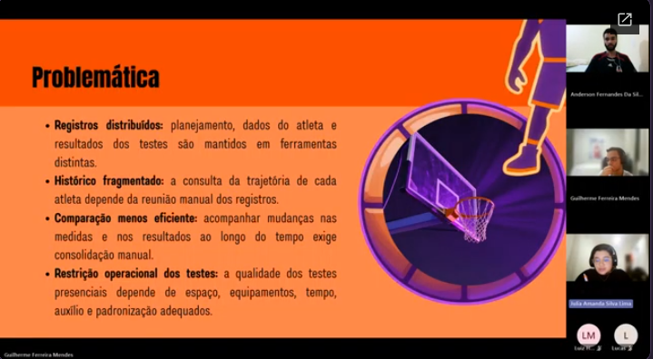
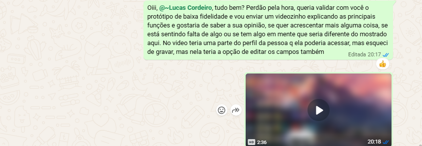

# Reuniões

Esta página reúne as atas das reuniões do projeto Space Jam. Os encaminhamentos e as pendências refletem a situação em cada encontro.

## Registros

As atas preservam discussões e encaminhamentos da data de cada encontro. Para consultar o escopo mantido nesta versão, use o [catálogo](requisitos.md); para entender mudanças posteriores, consulte o [histórico do Backlog](backlog.md#historico-de-revisao).

| Data | Encontro | Ata |
| --- | --- | --- |
| 14/09/2026 | Reunião da equipe | [Consultar ata](atas/2026-09-14-equipe.md) |
| 17/09/2026 | Reunião com Lucas | [Consultar ata](atas/2026-09-17-lucas.md) |
| 21/09/2026 | Reunião da equipe | [Consultar ata](atas/2026-09-21-equipe.md) |
| 21/09/2026 | Reunião com o monitor Heitor | [Consultar ata](atas/2026-09-21-monitor.md) |
| 26/09/2026 | Reunião com Lucas | [Consultar ata](atas/2026-09-26-lucas.md) |
| 28/09/2026 | Reunião da equipe | [Consultar ata](atas/2026-09-28-equipe.md) |
| 05/10/2026 | Reunião da equipe | [Consultar ata](atas/2026-10-05-equipe.md) |
| 08/10/2026 | Reunião com Lucas | [Consultar ata](atas/2026-10-08-lucas.md) |

## Evidências de ESW e ER

### Reunião de alinhamento com o brainstorm

{:  width="719" height="396" }

A captura mostra a apresentação da problemática. A data e a ata correspondente ainda precisam ser identificadas para relacioná-la à atividade registrada.

### Apresentação do protótipo inicial

[Abrir o protótipo no Figma](https://www.figma.com/design/HJ5ukxYtbpQDmzD2OO7Jw3/Space-Jam?node-id=31-864)

  
Ver protótipo de baixa fidelidade nesta página

  

    <iframe
      src="https://embed.figma.com/design/HJ5ukxYtbpQDmzD2OO7Jw3/Space-Jam?node-id=31-864&embed-host=share"
      title="Protótipo de baixa fidelidade do Space Jam no Figma"
      loading="lazy"
      allowfullscreen>
    </iframe>
  

O registro abaixo mostra o envio de um vídeo explicativo do protótipo de baixa fidelidade e uma reação positiva à mensagem:

{:  width="859" height="298" }

Para documentar a rodada de validação, ainda é necessário identificar a data, a versão apresentada, os fluxos e critérios avaliados, o retorno recebido e os ajustes decorrentes. O arquivo do Figma acima é uma referência navegável; seu estado atual não identifica, por si só, a versão apresentada nessa conversa.

??? abstract "Histórico de revisão"

    | Data | Versão | Descrição | Autor |
    | --- | --- | --- | --- |
    | 10/10/2026 | 0.4 | Registro das minutagens para consulta dos trechos relevantes. | Equipe Space Jam |
    | 10/10/2026 | 0.3 | Inclusão das atas disponíveis da equipe, do cliente e do monitor. | Equipe Space Jam |
    | 10/10/2026 | 0.2 | Preparação das atas de 17/09 e 08/10 e do registro parcial de 05/10. | Equipe Space Jam |
    | 14/09/2026 | 0.1 | Criação da página destinada ao registro das reuniões do projeto. | Equipe Space Jam |
